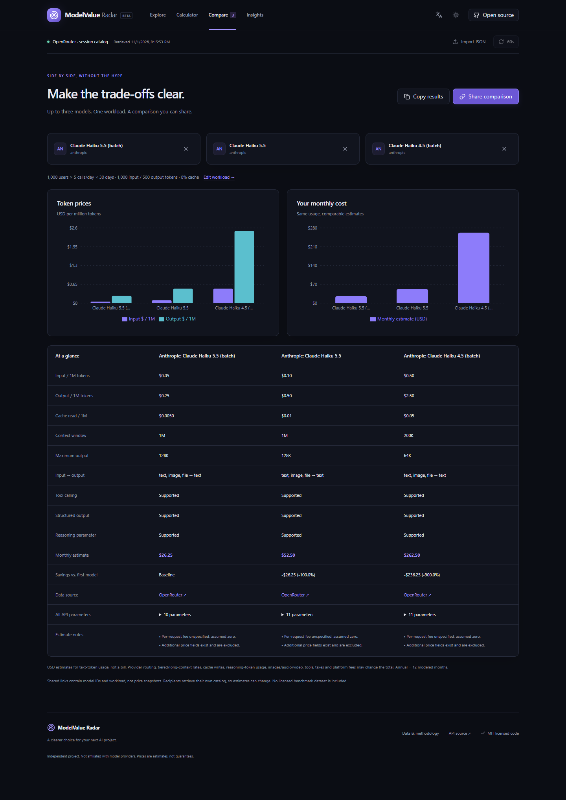
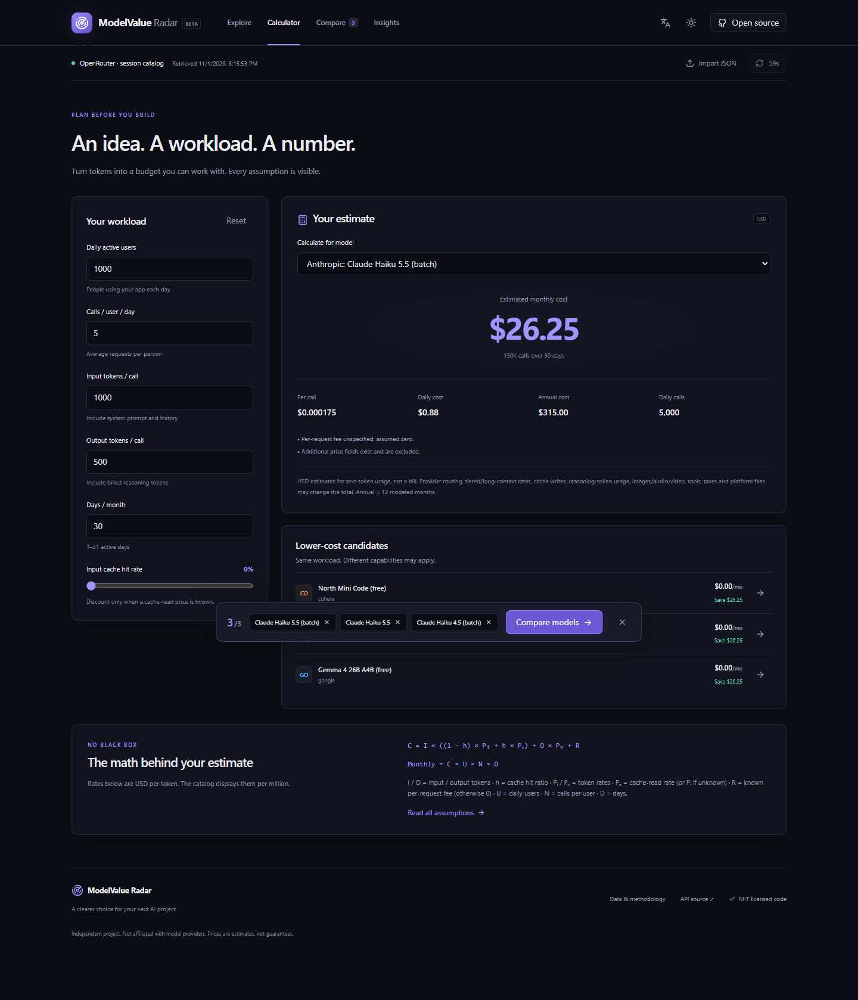

# ModelValue Radar

**Find the best AI model for your budget.**

Compare AI model prices **for the app you actually plan to build**. Enter your users, calls and token usage, then see monthly estimates and compare up to three candidates side by side.

- **Budget with your workload:** input/output tokens, cache hit rate, daily/monthly/yearly costs and savings.
- **Narrow the shortlist:** search, price/context/modality filters and six transparent use-case filters.
- **Share the decision:** comparison tables, charts and a link containing model IDs and workload.
- **Run it yourself:** static React app; no login, database, API key or paid inference call required under the observed public catalog access.

[简体中文](README.zh-CN.md) · [Quick Start](#quick-start) · [Screenshots](#see-it-in-action) · [Contribute](CONTRIBUTING.md) · [Data policy](docs/DATA_POLICY.md)

**Status:** v0.1.0 is prepared locally; no public release or hosted demo has been published yet. Use the local Quick Start below.

## Quick Start

Install **Node.js 24 LTS with npm** (Node 22.13+ on the 22.x line also works). Download/extract this repository or clone it using the URL of your own fork. Open the folder containing `package.json`:

```bash
npm ci
npm run dev
```

Open the local URL printed by Vite, then:

1. Click **Load official catalog**. The initial empty state is intentional: no model data is silently bundled.
2. Open **Calculator** and enter your users, calls and token usage.
3. Add up to three models in **Explore**, then open **Compare** and copy a share link.

The source request needs internet access. If it fails, the app explains the error and supports **Import JSON** for data you have permission to use. It does not substitute invented prices. [Setup, troubleshooting and the local npm fallback →](docs/QUICK_START.md)

## See it in action


These are real browser captures, not design mockups. Prices are dated observations, not current guarantees. [Capture time and provenance](docs/screenshots/README.md) · [All six images](docs/launch/MEDIA_GUIDE.md#available-images).

| Compare candidates                                                                | Plan a workload                                                                        |
| --------------------------------------------------------------------------------- | -------------------------------------------------------------------------------------- |
| [](docs/screenshots/compare.png) | [](docs/screenshots/calculator.png) |

[Light theme](docs/screenshots/explore-light.png) · [Chinese mobile view](docs/screenshots/mobile-zh.png) · [Recording walkthrough](docs/launch/MEDIA_GUIDE.md)

## What the numbers mean

**Price ranking is not quality ranking.** Scenario filters return matching candidates using declared modalities, API parameters and context limits. There are no invented capability scores, benchmark results or price histories.

```text
Per call = input × [(1 − cache hit rate) × input price + cache hit rate × cache-read price]
           + output × output price + known request fee
Monthly  = per-call cost × daily users × calls/user/day × days/month
Annual   = monthly × 12
```

Rates in this formula are USD/token; UI token prices are USD per million. Missing/dynamic prices stay unavailable. Unknown cache pricing falls back to ordinary input pricing with a warning. Context/output limits are checked. Free token pricing can still have quotas and availability limits.

This is a **text-token estimate, not a bill**. Cache writes, tiers/long-context premiums, media, tools, taxes, platform fees and provider-routing differences are excluded. [Formula, test examples and architecture →](docs/REFERENCE.md)

## Data, freshness and privacy

- The default provider reads the [official OpenRouter models API](https://openrouter.ai/docs/api/api-reference/models/list-all-models-and-their-properties) only after you load it. No full catalog, persistent cache or server mirror is shipped.
- “Retrieved” means receipt in your tab, **not when a price changed**. A visible tab refreshes after six hours; failures preserve the last successful data. Imports have unverified source age and are not automatically replaced.
- Calculations/imports run locally. Only language and theme use local storage; there is no analytics or login. OpenRouter receives connection metadata for direct source requests.
- New share URLs keep IDs/workload in the `#` fragment, away from hosting query logs. Recipients and browser history can still see them. Old query links are compatible but may have been logged. Links reload current data; they do not freeze prices.
- A separate six-hour Actions health check is **off by default**. It records status metadata, never publishes a catalog or redeploys the site.

Public API access is not permission to redistribute data. Before operating a public integration or promoting screenshots, review [source terms](https://openrouter.ai/terms), our [data policy](docs/DATA_POLICY.md) and [third-party notices](THIRD_PARTY_NOTICES.md). Broad catalog redistribution rights have not been established.

## Develop and deploy

React + TypeScript + Vite, Tailwind CSS, local shadcn/ui-style Radix/CVA primitives, Recharts, Lucide and Zod. Vitest/Testing Library cover logic; Playwright/axe cover browser flows. Charts and secondary pages are lazy-loaded; hash navigation supports GitHub Pages subpaths.

```bash
npm run lint
npm test
npm run build          # dist/; TypeScript checked first
npm run preview        # local production preview
```

The 2026-11-01 local review recorded **94 unit/component tests** and **72 browser tests** passing at 375px, 768px and 1440px. These are reproducible checks, not usage metrics or universal compatibility claims. [Review and limitations](docs/ENGINEERING_REVIEW.zh-CN.md) · [Full test commands](CONTRIBUTING.md).

GitHub Pages deployment is configured, but has **not run remotely**. For your own deployment, put this project at the repository root, select **Settings → Pages → GitHub Actions**, and follow the [complete launch checklist](docs/launch/GITHUB_PAGES_CHECKLIST.md). It covers data rights, first deployment, smoke testing, rollback and release approval. Never place secrets in `VITE_` variables.

## Contribute

Start with one of [three scoped beginner tasks](docs/good-first-issues/README.md): accessible input hints, request-fee details, or Escape-to-clear search. These are ready-to-file issue drafts, not already-open GitHub issues. English and Chinese contributions are welcome. [Contribution guide](CONTRIBUTING.md) · [Code of conduct](CODE_OF_CONDUCT.md) · [Security reporting](SECURITY.md).

Next: real-device/browser audits, better endpoint/tier estimates, and authorized snapshot providers. Benchmark rankings or history will be added only with verifiable data and permission. [v0.1.0 release draft](docs/releases/v0.1.0.md) · [Changelog](CHANGELOG.md).

## License

Original code and documentation: [MIT](LICENSE). Dependencies, third-party model data, brands and source-data screenshots keep their own rights; see [THIRD_PARTY_NOTICES.md](THIRD_PARTY_NOTICES.md). Independent project, not affiliated with OpenRouter or model providers.
