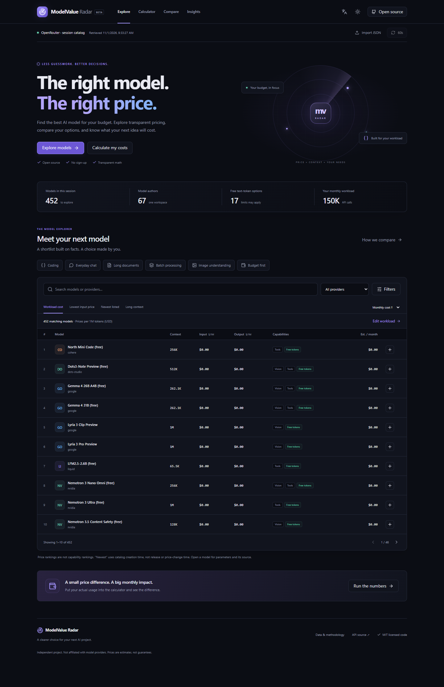

# ModelValue Radar

**Find the best AI model for your budget.**

A free, open-source **AI Model Comparison & Cost Calculator** for developers, students, and AI enthusiasts. Discover models, estimate an application budget, and compare up to three options using transparent assumptions.

[简体中文](README.zh-CN.md) · [Contributing](CONTRIBUTING.md) · [Data policy](docs/DATA_POLICY.md) · [Security](SECURITY.md)

**Online demo placeholder:** `https://YOUR_USERNAME.github.io/modelvalue-radar/` — not yet published. Replace this after your own deployment. There is no account, database, API key, paid service, or inference call required by the application.



Actual running product with an official OpenRouter response, not a mockup. Screenshots capture a moment in time and are not current pricing guarantees. [Capture provenance and more screenshots](docs/screenshots/README.md).

## What you can do

| Tool                 | Behavior                                                                                                                                                 |
| -------------------- | -------------------------------------------------------------------------------------------------------------------------------------------------------- |
| Discover             | Search; combine provider, modality, parameter, context, input/output price and monthly-budget filters; paginate results.                                 |
| Rank                 | Lowest input/output price, free text tokens, newest catalog entries, longest context, or lowest cost for **your** workload.                              |
| Calculate            | Daily users, calls/user/day, input/output tokens, active days and input-cache ratio → per-call, daily, monthly and yearly USD estimates.                 |
| Compare              | Up to three models, token-price bars, monthly-cost bars, capability declarations, complete parameter lists and relative savings.                         |
| Find candidates      | Coding, chat, long documents, structured text processing, image understanding and budget-first hard filters. Adjustable cost/context preference weights. |
| Explore prices       | Interactive input/output scatter plot, price ceiling and accessible data table.                                                                          |
| Share                | Versioned links with model IDs and workload; copy results, with a manual clipboard fallback.                                                             |
| Understand freshness | Last successful retrieval, six-hour stale warning, refresh errors and explicit unknown prices.                                                           |

Dark by default; light mode and English/Chinese are supported. Mobile model rows reorganize into readable labeled lists. Keyboard focus, semantic tables, native modal focus management, skeletons, errors and reduced-motion behavior are included.

**Price rankings are not capability rankings.** The project ships no benchmark scores or fabricated price history. Scenario results are _matching candidates_, not claims of best quality.

## Run locally

Prerequisite: Node.js **22.13+**, preferably Node 24, with npm installed and available in your terminal.

```bash
git clone https://github.com/YOUR_USERNAME/modelvalue-radar.git
cd modelvalue-radar
npm install
npm run dev
```

Use the localhost URL printed by Vite. Click **Load official catalog** to make one direct request to OpenRouter, or **Import JSON** to use a catalog you have permission to use. The initial empty state is intentional: no third-party catalog is silently bundled, mirrored, or replaced with fake data.

```bash
npm run build         # TypeScript checks + production output in dist/
npm run preview       # Local production preview, not a production server
npm run lint
npm run format:check
npm test
npm run test:coverage
npx playwright install chromium
npm run test:e2e
npm run test:build    # Builds and smoke-tests a /modelvalue-radar/ deployment
```

For a locked, reproducible install use `npm ci`. `.env.example` lists public configuration; copy it to `.env` only if you need a custom base path. **Every `VITE_` value is public. Never put keys in one.**

If Playwright browser downloads are restricted, an installed Edge can be used locally:

```powershell
$env:PLAYWRIGHT_CHANNEL = 'msedge'
npm run test:e2e
```

This fallback is optional; CI downloads standard Chromium. On a restricted corporate network, configure trusted proxy and CA settings for Node/browser tools rather than disabling certificate checks. The website will show a clear source error if OpenRouter cannot be reached; local import remains usable.

## Cost math

All internal rates are **USD per token**; displayed token prices are multiplied by 1,000,000.

```text
C = I × [(1 − h) × Pi + h × Pc] + O × Po + R
Daily calls   = U × N
Monthly calls = U × N × D
Daily cost    = C × U × N
Monthly cost  = C × U × N × D
Annual cost   = Monthly cost × 12
Savings       = baseline monthly cost − candidate monthly cost
```

`I/O`: input/output tokens per call; `h`: input-cache ratio; `Pi/Po`: input/output rates; `Pc`: cache-read rate; `R`: known per-request fee; `U`: daily users; `N`: calls/user/day; `D`: modeled days/month.

Independent test example: 1,000 users × 5 calls × 30 days, with 1,000 input and 500 output tokens at **test-only** rates $2/$8 per million, costs **$900/month**. A 50% cache ratio at a $0.50/M read rate gives **$787.50/month**. These are math fixtures, not advertised model prices.

- Missing/dynamic prices return unavailable, not zero. Non-text output is not estimated.
- Missing cache-read prices use the normal input rate with a warning; no invented discount.
- Unknown request fees are assumed zero with a warning.
- Known context/output overflow blocks estimates; unknown context is flagged.
- Structured tier overrides and additional price fields are retained as exclusions, not silently flattened into a false exact bill.
- Cache writes, tier/long-context premiums, media, tools, taxes, platform fees and routing differences are excluded. Include billed reasoning tokens in output usage when applicable. Annual cost means 12 modeled months, not necessarily 365 days. Free tokens can have quota/availability limits.

## Data source and rights

The default adapter uses the [official OpenRouter models API](https://openrouter.ai/docs/api/api-reference/models/get-models), at `https://openrouter.ai/api/v1/models`. During implementation, anonymous HTTP 200 and browser CORS access were observed; the generated reference also describes bearer authentication. **Observed public access is not a redistribution license or a guarantee of future anonymous access.** No key is embedded, requested or stored.

Review the [source terms](https://openrouter.ai/terms), [limits documentation](https://openrouter.ai/docs/api-reference/limits), and [detailed data policy](docs/DATA_POLICY.md) before operating a public integration. A clear blanket right to mirror/redistribute the entire catalog was not established, so the repository contains **no production catalog snapshot**, server mirror, or catalog commits. Browsers load on request and keep the result in memory. There is no persistent catalog cache or full-catalog export. Local imports remain on the device and are labeled with unverified source age.

“Retrieved” records successful receipt in this tab. It is **not the actual price-change time**. A model's `created` timestamp is catalog creation, not necessarily release date. The ID prefix labels a model author, not the routed inference provider. “Supported” means advertised by the source, not an independently measured guarantee. Imported records are not independently verified.

The code uses MIT. **Third-party data, trademarks and any future benchmark datasets are not relicensed under MIT.** Test fixtures are synthetic, explicitly named `TEST ONLY`, and never served as production models. No Demo Data is shipped.

## Refresh and scheduled checks

- After the visitor loads the source, a **visible open tab** checks whether data is at least six hours old and then refreshes. Closed/hidden tabs do not poll. This is periodic retrieval, not second-by-second pricing.
- Failed refreshes retain the previous catalog and show an error/stale warning. Requests have a one-minute minimum cooldown and honor longer `Retry-After` values. There is no automatic immediate retry loop.
- `.github/workflows/check-data.yml` provides `workflow_dispatch` plus `17 */6 * * *` (UTC). It is **opt-in**: after reviewing usage rights, set repository **Actions variable** `ENABLE_CATALOG_CHECK=true`.
- The check validates a response in memory and uploads only status, counts, time, and failure reason as a 30-day artifact. The Actions summary shows each result; earlier successful runs record the last successful check. It never commits a directory, changes the current website, or triggers a deploy. No data means no repetitive data commits.
- The browser timestamp and CI health-check timestamp describe separate requests. They are deliberately not conflated.
- Without the repository variable, the scheduled job is skipped. Manual browser refresh/import works independently. Future authorized snapshots can be introduced through the `DataProvider` interface after permission, schema, retention and failure behavior are documented.

Local health check (explicit opt-in; no snapshot written):

```powershell
$env:CATALOG_CHECK_ENABLED = 'true'
npm run check:data
```

## Architecture

React + strict TypeScript + Vite; Tailwind CSS 4; local shadcn/ui-style Radix/CVA button primitives; Recharts; Lucide; Zod runtime validation; Vitest + React Testing Library; Playwright + axe; GitHub Actions and Pages.

Native labeled inputs/selects and the native modal dialog keep keyboard behavior simple. No router package is needed: hash navigation works under GitHub Pages without rewrite rules. Charts and secondary pages are lazy-loaded; system fonts avoid a third-party font request. Only theme/language use local storage.

```text
src/
  components/       # Shared controls, charts, statuses, detail dialog
    ui/             # Locally owned shadcn/ui-style primitives
  pages/            # Explore, Calculator, Compare, Insights, Methodology
  hooks/            # Catalog lifecycle, language, cost warnings
  lib/              # Pure math/filter/share logic + data-provider boundary
  types/            # Normalized model, catalog and workload types
  test/             # Test-only fixtures and setup
scripts/            # Metadata-only source check and real screenshot capture
tests/e2e/          # Deterministic browser flows with synthetic API fixtures
docs/               # Data policy, screenshots, validation notes
.github/            # CI, Pages, optional catalog check, contribution templates
```

## Deploy to GitHub Pages

1. Create your own **public** GitHub repository named `modelvalue-radar`. Review source terms before making a public integration available. No repository has been created or pushed by this local delivery.
2. Upload this **project directory as the repository root**, including `package-lock.json` and `.github/`. Do not upload `node_modules`, `.tooling`, parent workspace files, `.env`, `dist` or local imports.
3. In **Settings → Pages → Build and deployment**, choose **GitHub Actions**. Set the `github-pages` environment to allow deployment from `main` only.
4. Push your reviewed `main` branch, or run **Deploy GitHub Pages** manually. The workflow checks lint/tests, builds, uploads `dist`, then deploys. A failed build cannot replace the previous deployment.
5. The workflow obtains `base_path` from `actions/configure-pages`, so project URLs, user sites and custom domains use the appropriate asset path. Hash routes and query-based share state stay under that path.
6. Replace the demo placeholder here and in the Chinese README with the resulting URL. Optional: enable the catalog health-check variable described above and private vulnerability reporting.

For manual project-path builds, set `VITE_BASE_PATH=/modelvalue-radar/` before `npm run build` (PowerShell: `$env:VITE_BASE_PATH='/modelvalue-radar/'`). Use `/` for a custom domain. See the official [Vite static-deployment guide](https://vite.dev/guide/static-deploy) and [GitHub Pages workflow guide](https://docs.github.com/en/pages/getting-started-with-github-pages/using-custom-workflows-with-github-pages).

CI tests code and mocked flows without consuming the model API. Real source checking is a separate opt-in workflow. Scheduled Actions can be delayed or disabled by GitHub; they are not an uptime guarantee. Remote workflows and actual publication need your GitHub account and have not been executed by this local delivery.

## Validation and limitations

See [VALIDATION.md](docs/VALIDATION.md) for actual commands/results and known environment limits. Browser tests cover desktop and a mobile viewport using a Chromium engine; automated axe checks are a useful baseline, not a claim of universal accessibility conformance. No real iOS/Android device or production GitHub environment is claimed to have been tested.

Source availability, metadata correctness, price tiers and permissions remain upstream constraints. No offline production dataset, capability benchmark, or price trend is invented to hide those limits. Shared links intentionally reload current data rather than freeze prices.

## Contribute and roadmap

Read [CONTRIBUTING.md](CONTRIBUTING.md) and [CODE_OF_CONDUCT.md](CODE_OF_CONDUCT.md). Small, well-tested fixes, translation improvements, accessibility reviews and documented provider adapters are welcome.

- [ ] Written authorization for redistributable, versioned catalog snapshots.
- [ ] Provider endpoint / long-context tier and cache-write-aware estimates.
- [ ] A licensed benchmark integration with metric/version attribution.
- [ ] Real-device and additional-browser accessibility testing.
- [ ] Historical trends **only** after real, permitted snapshots exist.
- [ ] More currencies using a documented exchange-rate source and date.

See [CHANGELOG.md](CHANGELOG.md) for release notes. The project is independent and not affiliated with OpenRouter or model providers.
