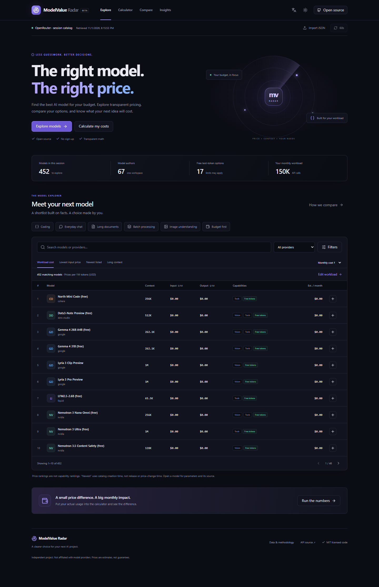
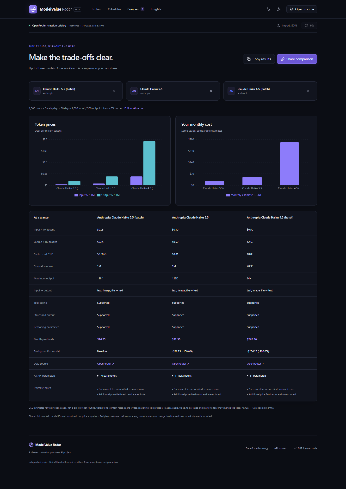
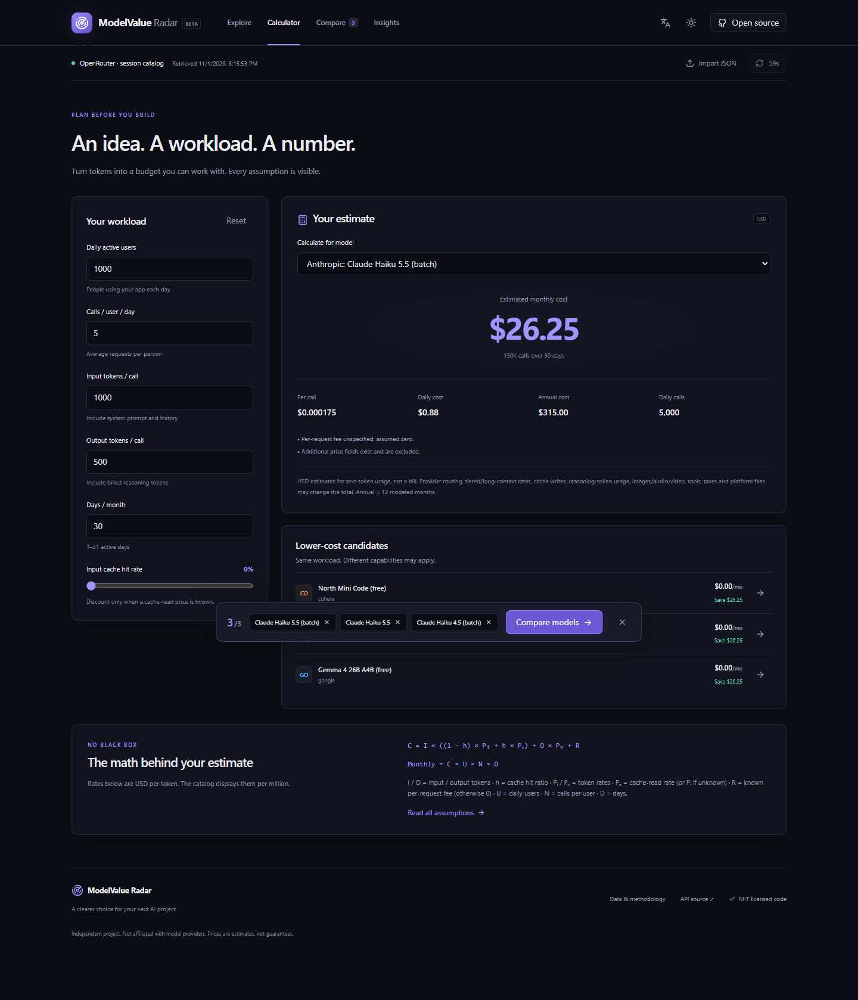

# ModelValue Radar

**Find the best AI model for your budget. — 找到适合你预算的 AI 模型。**

准备做一个 AI 应用，却不知道每月会花多少钱？输入日活、调用次数和 Token 用量，ModelValue Radar 帮你算出候选模型的费用，再把最多三个方案放在一起比较。

- **按你的用量算预算**：输入/输出 Token、缓存命中率、日/月/年费用与节省金额。
- **按实际条件筛选**：价格、上下文、模态、API 参数，以及六类使用场景。
- **分享选择依据**：并排表格、图表和包含模型 ID、用量的分享链接。
- **本地即可运行**：纯前端，无登录、数据库或付费推理调用；当前实测公共目录无需密钥。

[English](README.md) · [快速开始](#快速开始) · [产品截图](#看看实际界面) · [参与贡献](CONTRIBUTING.md) · [数据政策](docs/DATA_POLICY.md)

**当前状态：** 已准备 v0.1.0，本地可运行；尚未发布 GitHub Release 或在线 Demo。请先按下面的步骤试用。

## 快速开始

安装包含 npm 的 **Node.js 24 LTS**，也支持 Node 22.x 的 22.13 及以上版本。下载并解压仓库，或使用你自己 Fork 的地址克隆；在包含 `package.json` 的目录运行：

```bash
npm ci
npm run dev
```

打开 Vite 输出的本地网址：

1. 点击 **加载官方目录**。首次打开为空是正常状态，项目没有内置第三方模型快照。
2. 进入 **计算器**，调整用户数、调用量和 Token 用量。
3. 在 **发现** 页选择最多三个模型，进入 **对比** 查看费用差额并分享。

加载来源需要联网。接口不可达时会显示错误；也可以 **导入 JSON**，使用你有权使用的数据。页面不会用假价格代替失败结果。[详细安装、排错与本机 npm 启动方式 →](docs/QUICK_START.md)

## 看看实际界面



截图来自实际运行的浏览器，不是设计稿。价格只代表采集时刻，不保证当前报价。[采集时间与来源](docs/screenshots/README.md) · [六张截图索引](docs/launch/MEDIA_GUIDE.md#available-images)。

| 对比候选模型                                                              | 规划应用成本                                                                      |
| ------------------------------------------------------------------------- | --------------------------------------------------------------------------------- |
| [](docs/screenshots/compare.png) | [](docs/screenshots/calculator.png) |

[浅色主题](docs/screenshots/explore-light.png) · [手机中文界面](docs/screenshots/mobile-zh.png) · [90 秒录屏脚本](docs/launch/MEDIA_GUIDE.md)

## 能解决什么问题

| 你想知道的事                 | 对应功能                                                     |
| ---------------------------- | ------------------------------------------------------------ |
| 这个应用预计花多少钱？       | 同一用量下计算单次、日、月、年费用；检查上下文和输出限制。   |
| 哪些模型满足预算和接口要求？ | 组合筛选、排序、分页；按当前候选集合调整成本与上下文权重。   |
| 换模型可能省多少？           | 最多三个模型并排对比，以首个模型为基准显示差额。             |
| 缓存是否会降低估算？         | 只有已知缓存读取价格时使用该价格；缺价时按普通输入价并提示。 |
| 数据是不是刚刚变价？         | 显示的是获取时间，不把刷新时间当作价格实际变化时间。         |

**价格排名不等于能力排名。** 场景入口使用来源声明的参数做硬筛选，给出“符合条件的候选模型”，不会声称它们质量最佳。项目没有虚构能力分数、评测成绩或价格历史。

## 费用怎么算

```text
单次费用 = 输入 Token × [(1 − 缓存命中率) × 输入价 + 缓存命中率 × 缓存读取价]
           + 输出 Token × 输出价 + 已知请求费
月度费用 = 单次费用 × 日用户数 × 每用户每天调用次数 × 每月天数
年度费用 = 月度费用 × 12
```

公式费率为美元/Token，界面价格为美元/百万 Token。未知或动态价格不会当作免费。请求费未知时暂按零并提示，免费模型仍可能有配额和可用性限制。

这是**文本 Token 估算，不是完整账单**。缓存写入、阶梯及长上下文溢价、图像/音视频、工具、税费、平台费用和路由差异未计入。[完整假设、独立测试算例及架构](docs/REFERENCE.md)。

## 数据、更新与隐私

- 点击加载后才请求 [OpenRouter 官方 API](https://openrouter.ai/docs/api/api-reference/models/list-all-models-and-their-properties)。目录只在当前标签页内存中，不做服务器镜像、持久化缓存或完整目录导出。
- “获取于”不是价格变动日期。“最新上架”按目录创建时间排序，不保证是模型发布日期。提供商标签来自模型作者 ID，不一定是实际推理端点。
- 已加载目录在可见标签页满六小时后刷新；失败保留旧数据并提示。手动导入的原始时效未验证，也不会被自动替换。
- 用量计算和导入在本地完成，仅主题和语言使用 localStorage。没有分析追踪；直连 API 时来源会接收普通连接信息。
- 新分享链接把模型 ID 和用量放在 `#` 片段中，不发送给静态托管服务器，但接收者和浏览器历史仍可看到。旧查询链接保持兼容，可能已被托管日志记录。分享不会冻结价格。
- GitHub Actions 每六小时健康检查**默认关闭**；启用后只记录状态、数量、时间或失败原因，不提交目录、不触发重新部署。

接口公开可读不代表拥有再分发许可。公开运行或使用截图推广前，请核对 [来源条款](https://openrouter.ai/terms)、[数据政策](docs/DATA_POLICY.md) 和 [第三方权利说明](THIRD_PARTY_NOTICES.md)。本项目尚未确认完整目录的一揽子再分发授权。

## 开发与部署

React + 严格 TypeScript + Vite、Tailwind CSS、本地 shadcn/ui 风格 Radix/CVA 组件、Recharts、Lucide、Zod。图表和次要页面按需加载，hash 导航兼容 GitHub Pages 子路径。

```bash
npm run lint
npm test
npm run build          # TypeScript 校验后生成 dist/
npm run preview        # 本地预览生产构建
```

2026-11-01 本地审查中，**94 项单元/组件测试、72 项浏览器测试通过**，覆盖 375px、768px、1440px。它们是可复现的工程检查，不是用户数量、产品成绩或全面兼容性认证。[审查记录与限制](docs/ENGINEERING_REVIEW.zh-CN.md) · [完整测试命令](CONTRIBUTING.md)。

Pages 工作流已配置，但尚未在真实远程仓库执行。把本项目内容作为仓库根目录，在 **Settings → Pages** 选择 **GitHub Actions**，再按 [完整上线清单](docs/launch/GITHUB_PAGES_CHECKLIST.md) 完成许可核对、部署、验收和回滚准备。**不要在 `VITE_` 变量中存放密钥。**

## 一起改进

欢迎中英文 Issue 和 PR。新贡献者可以从 [三个独立的小任务](docs/good-first-issues/README.md) 开始：表单提示的无障碍关联、请求费详情、Escape 清空搜索。它们是可创建的 Issue 草稿，尚未发布到 GitHub。

[贡献指南](CONTRIBUTING.md) · [行为准则](CODE_OF_CONDUCT.md) · [安全报告](SECURITY.md) · [v0.1.0 发布说明草稿](docs/releases/v0.1.0.md)

后续方向包括实体设备/更多浏览器验证、更完整的端点和阶梯估算，以及取得授权后的快照提供者。真实评测或历史趋势需要先解决数据真实性与展示许可。[版本记录](CHANGELOG.md)。

## 许可证

原始代码和文档采用 [MIT](LICENSE)。依赖、模型数据、品牌及含第三方数据的截图保留各自权利，详见 [THIRD_PARTY_NOTICES.md](THIRD_PARTY_NOTICES.md)。本项目独立开发，与 OpenRouter 或模型提供商无隶属关系。
